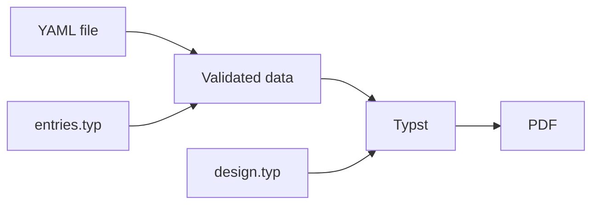

# Understanding RenderCV

This guide walks you through how RenderCV works, explaining each step and the tools we use.

## The Core Workflow

RenderCV does more than this (Markdown, HTML, PNG outputs, watching files, etc.), but at its core, what happens is:



Read a YAML file, validate it against the entry types declared in Typst, hand the result to Typst as data, and compile it to PDF with the design. Everything else is built on top of this foundation.

## What is Typst?

Before we dive into the steps, let's understand what [Typst](https://typst.app/) is.

Typst is a computer language. Just like Python, HTML, or JavaScript. You write Typst code to describe what a page should look like and what content it contains. You save it as a text file (`.typ` extension). When you compile a `*.typ` file with Typst compiler, you get a PDF.

## Who Does What

RenderCV is married to Typst. The rule is: **Typst defines things, YAML fills in values, and Python validates and connects them.**

- **Typst** defines everything with behavior or looks: the entry types (their fields and how they look) and the designs. They live in RenderCV's Typst package, [`typst/`](https://github.com/rendercv/rendercv/tree/main/typst), and in the user's `entries.typ` and `design.typ`.
- **YAML** holds pure data: the user's CV, and RenderCV's built-in [locales](https://github.com/rendercv/rendercv/tree/main/src/rendercv/data/locales) and [social networks](https://github.com/rendercv/rendercv/tree/main/src/rendercv/data/social_networks).
- **Python** ([`src/rendercv/`](https://github.com/rendercv/rendercv/tree/main/src/rendercv)) reads the YAML, asks Typst which entry types exist, validates the YAML against them, and hands the result to Typst.

## Step 1: Reading the YAML File

### [`ruamel.yaml`](https://github.com/pycontribs/ruamel-yaml): YAML Parser

Python doesn't have a built-in YAML library. **We use `ruamel.yaml`**, which converts YAML text into Python dictionaries:

```yaml
cv:
  name: John Doe
  sections:
    education:
      - institution: MIT
        area: Physics
        start_date: 2020-09
```

becomes

```python
{
    "cv": {
        "name": "John Doe",
        "sections": {
            "education": [
                {"institution": "MIT", "area": "Physics", "start_date": "2020-09"}
            ]
        },
    }
}
```

The dictionaries `ruamel.yaml` returns also remember the line and column of every value, which is how error messages point to the right line. Values tagged `!typst` become `TypstString`, a `str` subclass, so RenderCV knows to treat them as Typst markup instead of Markdown.

See [`schema/yaml_reader.py`](https://github.com/rendercv/rendercv/blob/main/src/rendercv/schema/yaml_reader.py). [`schema/rendercv_model_builder.py`](https://github.com/rendercv/rendercv/blob/main/src/rendercv/schema/rendercv_model_builder.py) then merges in the locale and settings files and the command-line overrides (`--cv.name "Jane"`).

## Step 2: Reading the Entry Types from Typst

Which entries a CV may have isn't written in Python. It's declared in Typst, with `entry-type` and `field`:

```typst
#let talk = entry-type(
  doc: "A talk at a conference or event.",
  fields: (
    title: field("markdown", doc: "The title of the talk."),
    event: field("markdown", doc: "Where the talk was given."),
    date: field("date", doc: "When the talk was given."),
    slides: field("url", optional: true, doc: "A link to the slides."),
  ),
  look: (it, ctx) => as-entry("normal", name: [#it.title -- #emph(it.event)], date: it.date),
)
```

`entry-type(...)` just returns a dictionary marked as an entry type (see [`typst/src/entry-type.typ`](https://github.com/rendercv/rendercv/blob/main/typst/src/entry-type.typ)). The user's `entries.typ` is a Typst module; `dictionary(module)` lists everything it defines or imports, and `collect-entry-types` keeps the entry types. Without an `entries.typ`, the module is RenderCV's package itself, which exports the standard entry types from [`typst/entries/standard.typ`](https://github.com/rendercv/rendercv/blob/main/typst/entries/standard.typ).

To get the declarations into Python, RenderCV compiles a tiny Typst file that puts them into a labeled `metadata` element, and reads it back with a query (`typst query` in the Typst CLI):

```typst
#import "@preview/rendercv:3.0.0" as rendercv
#import "/entries.typ" as entries
#let types = rendercv.collect-entry-types(dictionary(entries))
#metadata(rendercv.declarations(types)) <rendercv-declarations>
```

`declarations` drops the looks (functions aren't data) and keeps the fields:

```json
{
  "doc": "A talk at a conference or event.",
  "fields": {
    "title": {"kind": "markdown", "optional": false, "doc": "The title of the talk.", ...},
    "event": {"kind": "markdown", "optional": false, "doc": "Where the talk was given.", ...},
    "date": {"kind": "date", "optional": false, "doc": "When the talk was given.", ...},
    "slides": {"kind": "url", "optional": true, "doc": "A link to the slides.", ...}
  }
}
```

Python turns this JSON into `EntryTypeDeclaration`s. See `read_entry_type_declarations` in [`renderer/typst_compiler.py`](https://github.com/rendercv/rendercv/blob/main/src/rendercv/renderer/typst_compiler.py) and `parse_entry_type_declarations` in [`schema/models/cv/entry_types.py`](https://github.com/rendercv/rendercv/blob/main/src/rendercv/schema/models/cv/entry_types.py).

### [`typst`](https://github.com/messense/typst-py): Typst Compiler

The `typst` library is the Python binding of the Typst compiler. RenderCV uses it for everything Typst: querying declarations, compiling PDFs and PNGs, exporting HTML. It compiles from memory, so RenderCV never writes temporary Typst files.

## Step 3: Validating

### [`pydantic`](https://github.com/pydantic/pydantic): Python Dictionary Validator

We have a dictionary and we need to validate it. With `pydantic`, you define the structure once as a class, and `model_validate()` checks a dictionary against it:

```python
class Cv(BaseModel):
    name: str | None = None
    email: pydantic.EmailStr | None = None
    ...

cv = Cv.model_validate({"name": "John Doe", "email": "john@example.com"})
```

The fixed parts of the YAML are ordinary `pydantic` models: `RenderCVModel` holds `cv`, `locale`, and `settings` (see [`schema/models/rendercv_model.py`](https://github.com/rendercv/rendercv/blob/main/src/rendercv/schema/models/rendercv_model.py)).

Entries are different: their types come from Typst, so their models can't be written in Python. **RenderCV builds them at runtime** with `pydantic.create_model`, one per entry type, mapping each field kind to a `pydantic` type (`markdown` to text, `date` to a date validator, `url` to `HttpUrl`, and so on). See `build_entry_type_models` in [`schema/models/cv/entry_types.py`](https://github.com/rendercv/rendercv/blob/main/src/rendercv/schema/models/cv/entry_types.py).

Each entry is then validated in two steps (`validate_entry`):

1. **Find its type.** The entry's keys are compared with each type's fields: a type fits if the entry has all its required fields and nothing else. One fit is the type; several fits ask the user for a `type:` key; no fit picks the closest type, so the errors explain what's wrong with the entry compared to what the user most likely meant.
2. **Validate it** with that type's model. Unknown fields get a "Did you mean ...?" suggestion from `difflib`.

All problems in all entries are collected and reported together, each at its line in the YAML ([`schema/pydantic_error_handling.py`](https://github.com/rendercv/rendercv/blob/main/src/rendercv/schema/pydantic_error_handling.py) maps `pydantic` error locations to YAML lines).


## Step 4: The Data Contract

The validated model is turned into plain JSON: the **data contract** between Python and Typst. It holds everything Typst needs, fully resolved: dates split into parts, phone numbers in every format, social network URLs built, and text parsed into rich-text nodes. See [`renderer/document.py`](https://github.com/rendercv/rendercv/blob/main/src/rendercv/renderer/document.py).

```json
{
  "version": 1,
  "settings": {"current_date": {"year": 2026, "month": 9, "day": 23}, "bold_keywords": [], "pdf_title": "John Doe - CV"},
  "locale": {"language": "english", "iso_code": "en", "present": "present", ...},
  "header": {
    "name": ["John Doe"],
    "connections": [
      {"kind": "email", "icon": "envelope", "url": "mailto:john@example.com", "text": ["john@example.com"], ...}
    ],
    ...
  },
  "sections": [
    {
      "key": "experience",
      "title": ["Experience"],
      "entries": [
        {
          "type": "experience",
          "fields": {
            "company": ["Acme"],
            "position": ["Engineer"],
            "start_date": {"year": 2020, "month": 1},
            "highlights": [{"body": ["Cut costs by ", {"strong": ["$2M"]}], "children": []}]
          }
        }
      ],
      "subsections": []
    }
  ]
}
```

### [`markdown-it-py`](https://github.com/executablebooks/markdown-it-py): Markdown to Rich Text

Users write Markdown in their YAML. `markdown-it-py` parses it, and [`renderer/rich_text.py`](https://github.com/rendercv/rendercv/blob/main/src/rendercv/renderer/rich_text.py) turns the tokens into rich-text nodes:

```python
markdown_to_rich_text("**Published** [3 papers](https://example.com) on $2M #budgets")
# [{"strong": ["Published"]}, " ", {"link": {"url": "https://example.com", "body": ["3 papers"]}}, " on $2M #budgets"]
```

Plain strings stay plain strings, and Typst shows them literally ([`typst/src/rich.typ`](https://github.com/rendercv/rendercv/blob/main/typst/src/rich.typ)). **User text never becomes Typst code**, so `$`, `#`, `@`, or `"` can't break the document, and there is no escaping code to get wrong. Only a `!typst` value becomes a `{"typst": ...}` node, which Typst evaluates as markup on purpose.

## Step 5: Compiling

RenderCV builds a small main Typst file in memory. It imports RenderCV's package, the entry types, and the design, reads the data from `sys.inputs`, and calls `render`:

```typst
#import "@preview/rendercv:3.0.0" as rendercv
#import "/entries.typ" as entries
#let types = rendercv.collect-entry-types(dictionary(entries))
#let all-types = rendercv.collect-entry-types(dictionary(rendercv)) + types
#import "/design.typ" as design-file
#let design = if "design" in dictionary(design-file) { design-file.design } else { panic("...") }
#let data = json(bytes(sys.inputs.at("rendercv-data")))
#rendercv.render(data, types: all-types, design: design)
```

`typst-py` compiles it with the data JSON as `sys_inputs`, to PDF or PNG. The `.typ` file RenderCV writes to the output folder is the same file with the JSON embedded in a raw block, so it compiles on its own with the Typst CLI. See `build_main_source` in [`renderer/typst_compiler.py`](https://github.com/rendercv/rendercv/blob/main/src/rendercv/renderer/typst_compiler.py) and [`renderer/outputs.py`](https://github.com/rendercv/rendercv/blob/main/src/rendercv/renderer/outputs.py).

Where does `@preview/rendercv` come from? In a source checkout, it's the repository's `typst/` folder. In the Python package, [`hatch_build.py`](https://github.com/rendercv/rendercv/blob/main/hatch_build.py) bundles it at build time, together with the Typst packages it imports (like `@preview/fontawesome`, pinned by version and checksum), so RenderCV works offline. [`renderer/typst_packages.py`](https://github.com/rendercv/rendercv/blob/main/src/rendercv/renderer/typst_packages.py) lays them out where Typst looks for packages.

## Inside the Typst Package

### Rendering and Hand-Overs

[`typst/src/render.typ`](https://github.com/rendercv/rendercv/blob/main/typst/src/render.typ) draws the document: the design's `document` wraps everything, `layout` arranges the `header` and the sections, `section` draws each section, and every entry is drawn by `render-entry`:

1. The entry's JSON fields become Typst values (`markdown` becomes content, `date` a dictionary, and so on; see [`typst/src/values.typ`](https://github.com/rendercv/rendercv/blob/main/typst/src/values.typ)).
2. The look is the design's look for the entry's type if it has one, otherwise the entry type's own look.
3. If the look returns a hand-over, `as-entry("normal", name: ..., date: ...)`, the entry becomes an entry of that type with those fields, and step 2 repeats (at most 16 times, to catch loops).

Hand-overs are how the standard types stay simple and designs stay small: `experience`, `education`, and `publication` hand over to `normal`, so a design that only styles `normal` already draws all of them. A user's `talk` hands over to `normal` too, so every design draws it without knowing it exists. A design that wants to style `experience` differently just adds a look for it.

### Designs Are Dictionaries

A design is a dictionary of functions: `document`, `layout`, `header`, `section`, and `entries` (entry type names to looks). `render` merges it over `base-design`, which draws plain semantic Typst, so a design only has to define what it changes.

The built-in designs come from one function, `engine` in [`typst/designs/engine.typ`](https://github.com/rendercv/rendercv/blob/main/typst/designs/engine.typ). It takes resolved options and returns the design dictionary. Each built-in design is the engine with its own defaults and a few looks of its own:

```typst
#let moderncv(..options) = engine(
  resolve-options(moderncv-defaults, options.named()),
  name: "moderncv",
  entries: moderncv-entries,
)
```

`resolve-options` merges the engine's `defaults`, the design's defaults, and the user's options with `merge-options` ([`typst/src/options.typ`](https://github.com/rendercv/rendercv/blob/main/typst/src/options.typ)), which stops with an error on unknown options and values of the wrong type. `entries` receives the options and the engine's building blocks (`regular-entry`, `entry-dates`, ...), so designs arrange entries without repeating the layout code.

### Markdown and HTML

Markdown and HTML come from the same Typst document, drawn with `base-design` so they contain only semantic elements (headings, paragraphs, lists, links, emphasis):

- **HTML** is Typst's HTML export of that document.
- **Markdown** comes from walking that document's content and writing each element as Markdown ([`typst/src/markdown.typ`](https://github.com/rendercv/rendercv/blob/main/typst/src/markdown.typ)); RenderCV reads the result with a query, like the declarations.

## The Complete Pipeline

When you run `rendercv render cv.yaml`:

1. **Parse**: `ruamel.yaml` reads the YAML, the locale and settings files, and the overrides into a dictionary.
2. **Declare**: `typst-py` queries the entry types' declarations from `entries.typ` (or the standard ones).
3. **Validate**: `pydantic` models built from the declarations validate the entries; `RenderCVModel` validates the rest.
4. **Hand over**: the model becomes the data contract, with Markdown parsed by `markdown-it-py` into rich-text nodes.
5. **Compile**: `typst-py` compiles an in-memory main file with RenderCV's package, `entries.typ`, `design.typ`, and the data, to PDF, PNG, and HTML, and queries it for Markdown.

## Learn More

- [`src/rendercv/renderer/project.py`](https://github.com/rendercv/rendercv/blob/main/src/rendercv/renderer/project.py): `load_project`, steps 1 to 4
- [`src/rendercv/cli/render_command/run_rendercv.py`](https://github.com/rendercv/rendercv/blob/main/src/rendercv/cli/render_command/run_rendercv.py): the complete flow of `rendercv render`
- [`typst/lib.typ`](https://github.com/rendercv/rendercv/blob/main/typst/lib.typ): everything the Typst package exports
