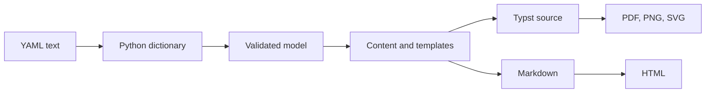

# Understanding RenderCV

RenderCV turns a description of a CV into a typeset document. The user writes the content in YAML; RenderCV checks it and generates Typst code; Typst lays out the pages and produces the PDF.



Each step changes the representation of the same CV. Keeping those steps separate lets us change a layout without changing how dates are validated, for example.

## Reading YAML

YAML is a text format for structured data. Indentation groups fields, and a dash introduces a list item. A **parser** reads that text and turns it into values a program can use. For example:

```yaml
cv:
  name: John Doe
  location: London
```

becomes a Python dictionary:

```python
{"cv": {"name": "John Doe", "location": "London"}}
```

Python has no built-in YAML parser. RenderCV uses [ruamel.yaml](https://yaml.dev/doc/ruamel.yaml/) in [`yaml_reader.py`](https://github.com/rendercv/rendercv/blob/main/src/rendercv/schema/yaml_reader.py). It also retains the original line numbers, so an error can point to the value in the user's file.

The model builder then combines the main CV with any separate design, locale, settings, and overlay files, followed by command-line overrides. An overlay changes selected values: dictionaries merge by key; lists and individual values replace earlier ones. Validation happens after this combination, so it checks the data that will actually be rendered.

## Validating the data

Parsing establishes what the YAML says. **Validation** checks whether those values make sense for RenderCV: a name must be text, a date must be valid, and an end date cannot precede its start date.

[Pydantic](https://docs.pydantic.dev/latest/) lets us describe a data structure with Python classes and type annotations. Here is a small example, separate from RenderCV's full model:

```python
from pydantic import BaseModel


class Person(BaseModel):
    name: str
    location: str | None = None


person = Person.model_validate({"name": "John Doe"})
assert person.name == "John Doe"
assert person.location is None
```

`name: str` requires a string. `location: str | None = None` permits a string or no value and supplies a default. Calling `model_validate` checks the dictionary and returns an object whose fields can be accessed as attributes. Invalid input raises a validation error that identifies the field. Additional validator functions express rules involving values, such as the order of two dates.

RenderCV's [`RenderCVModel`](https://github.com/rendercv/rendercv/blob/main/src/rendercv/schema/models/rendercv_model.py) has four fields: `cv`, `design`, `locale`, and `settings`. Each contains further Pydantic models, so validation follows the structure down to individual entries and settings. Rules involving several top-level fields belong on `RenderCVModel`.

Validation also prepares input resources: it checks local photos, downloads remote photos, and checks custom template syntax. Paths in YAML resolve from the main CV file's directory; explicit command-line paths resolve from the directory where the command runs.

This is the boundary between input handling and rendering. Invalid input gets a useful diagnostic during validation. Afterward, the renderer should produce the requested files; an unexpected exception remains a bug to investigate, rather than being presented as another input error.

## Understanding formatted content

A field can contain Markdown such as `**Published** [three papers](https://example.com)`. Typst uses different syntax, so copying that string directly would not preserve its meaning.

RenderCV uses [markdown-it-py](https://markdown-it-py.readthedocs.io/) to parse the formatting. Its [`markup.py`](https://github.com/rendercv/rendercv/blob/main/src/rendercv/renderer/templater/markup.py) represents the result as a tree: a bold node contains the word “Published”; a link node contains its text and destination. The nodes are immutable, meaning a transformation creates new nodes instead of changing the old ones. Custom parser rules also recognize Typst expressions and `$$math$$`.

Working with this structure lets keyword bolding change visible words without changing a link's URL or a code example. It also lets entry templates substitute fields: `**COMPANY**, POSITION` combines two values, while a missing position removes its connecting comma.

A writer then converts the tree into Typst or Markdown syntax. It **escapes** characters that should appear literally, so punctuation in a name is not accidentally treated as formatting. [`model_processor.py`](https://github.com/rendercv/rendercv/blob/main/src/rendercv/renderer/templater/model_processor.py) prepares a copy of the model for each output format, including dates, labels, and these formatted fields.

## Assembling a document with templates

A template is text with places for values and instructions for optional or repeated parts. [Jinja](https://jinja.palletsprojects.com/) fills those places. For example, this simplified template:

```jinja2
= {{ cv.name }}

{{ cv.location }}

```

produces this text when the supplied name is John Doe and location is London:

```typst
= John Doe
London
```

`{{ ... }}` inserts a value; `` includes text only when the condition holds. Python prepares the values, while the templates describe their arrangement.

RenderCV's [`templater.py`](https://github.com/rendercv/rendercv/blob/main/src/rendercv/renderer/templater/templater.py) assembles the document setup, header, sections, and entries. A subsection uses the section renderer at the next heading level. The loader looks for user templates beside the input before falling back to built-in ones, allowing [custom layouts](../user_guide/how_to/override_default_templates.md) without editing the installed package.

HTML needs its own escaping: `<` in a title must remain text. Jinja escapes those values automatically. The already-generated HTML body uses the `safe` filter so its tags remain markup. That filter skips escaping; it does not check whether arbitrary HTML is safe.

## Turning Typst code into pages

[Typst](https://typst.app/) is a language for typesetting documents. Its source describes content, styles, and layout; its **compiler** calculates page positions and produces the output. The `= John Doe` line above, for example, describes a heading.

The `typst` Python package lets Python call that compiler. [`pdf_png.py`](https://github.com/rendercv/rendercv/blob/main/src/rendercv/renderer/pdf_png.py) passes it generated source and the fonts and Typst packages needed to render it. The source can stay in memory, so disabling the saved `.typ` file does not disable PDF output. PNG and SVG contain one image per page. HTML is generated from the Markdown output instead.

[`run_rendercv.py`](https://github.com/rendercv/rendercv/blob/main/src/rendercv/cli/render_command/run_rendercv.py) coordinates these steps and reports progress. Watch mode runs them again when an input file changes. Follow that function to see how the pieces connect; the [testing guide](testing.md) explains how we check their behavior.
